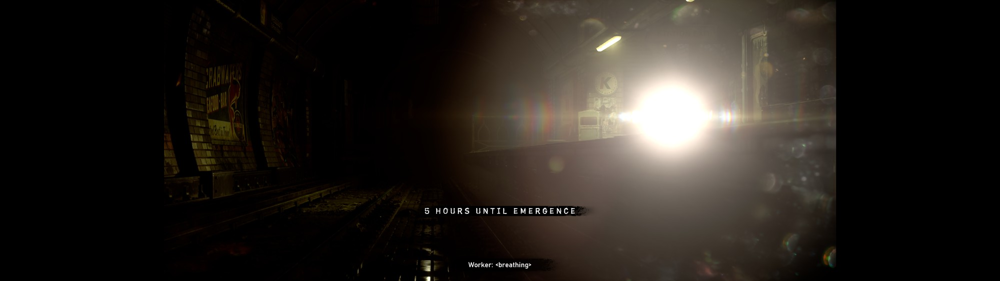
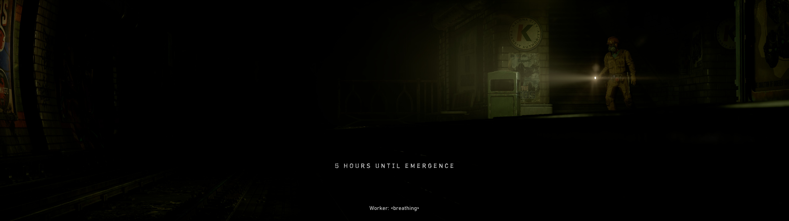
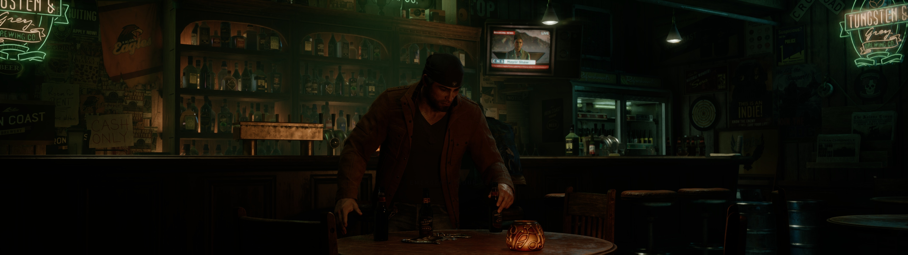

# Gears of War: E-Day (Ultrawide & FOV Fix) :  Xbox Game Pass

[](https://github.com/Ferosnow95/EDayUltrawide/releases)
[](https://github.com/Ferosnow95/EDayUltrawide/releases)

A plain and simple mod that fixes Gears of War: E-Day on super-ultrawide screens (32:9 and anything wider than 21:9). It removes the black side bars in cutscenes, fixes the cropped / cut-off picture you get once the bars are gone, and adds separate FOV sliders for cutscenes and gameplay.

**This is for the Xbox app / Game Pass (PC) version only. It is not for the Steam version.**

Windows only. Single-player / offline only (see [Anti-cheat](#anti-cheat)).

<table>
<tr><th width="50%">Before (stock, 32:9)</th><th width="50%">After (this fix, 32:9)</th></tr>
<tr>
<td></td>
<td></td>
</tr>
</table>

**Another cutscene (32:9, with the fix)**



## Features
- **Removes the black bars** in cutscenes on 32:9 and other screens wider than 21:9.
- **Fixes the cropping:** the cutscene camera keeps the same top-to-bottom view as 16:9 (Hor+), so you see more on the sides and nothing is cut off at the top or bottom. The slight downward tilt that wide screens get is corrected too, so faces and scenes aren't sitting low in the frame.
- **Separate FOV controls:** one slider for cutscenes (50–150 %, 100 % = the 16:9 framing) and one for gameplay (60–150°, the game's own slider stops at 90). Each one is independent of the other.
- **Changes apply instantly** while the game runs, and are saved.
- **Small window app** with Start, install/remove and log buttons, so no `.bat` files or command line.
- **One-key A/B toggle** (F8) and a log file for troubleshooting.

## Requirements
- Gears of War: E-Day from the **Xbox app / Game Pass for PC**.
- Windows 10/11 (.NET Framework 4.8 is built in).
- In the game: **Graphics settings → Cinematic Ultrawide Support = ON**.

## Install (Xbox Game Pass version)
1. Download the latest zip from [Releases](https://github.com/Ferosnow95/EDayUltrawide/releases) and extract it.
2. Copy the extracted files into the game's `WinGDK` folder:
   `<your Xbox games folder>\Gears of War- E-Day\Content\FairlightConcept\Binaries\WinGDK\`
   (in the Xbox app: *Gears of War: E-Day* → ⋯ → *Manage* → *Files* → *Browse…* to find the game folder).
3. Double-click **`EDayUltrawide-InstallHook.exe`** and approve the Windows prompt (it needs administrator rights once, to make the Xbox app start the fix with the game).
4. Start the game with **Play in the Xbox app**, as normal. The fix window opens minimised in the taskbar: click it to change the FOV. It closes when the game does.

Why the Xbox app has to start it: the Game Pass build only runs when the Xbox app launches it, so the fix is started by the Xbox app and starts the game itself.

To remove it, double-click **`EDayUltrawide-Restore.exe`**. A game update or *Repair* in the Xbox app puts the original launcher back; run `EDayUltrawide-InstallHook.exe` again.

### Online play
The fix starts the game with anti-cheat off. To play online, hold **Shift** while you press Play (a normal launch, no fix), or tick *Always start online* in the window.

## The window
| Section | What it does |
|---|---|
| **Ultrawide fix on** | Master switch. Off puts the bars and the game's own FOV back. |
| **Cutscenes** | *Cutscene FOV* 50–150 %: 100 % is the same view as 16:9, higher shows more, lower zooms in. *Keep the 16:9 vertical framing* turns the Hor+ correction on/off. |
| **Gameplay** | *Override the gameplay FOV* 60–150°. Unticked = the game's own value; it is put back when you untick it or close the game. |
| **Game** | Start the game, install/remove the launch hook, *Always start online*, open the log. |

Closing the window while the game runs only minimises it (the fix lives in it); it closes with the game. The gameplay camera is found once you are in a level, which takes a few seconds.

## Controls
| Key | Action |
|---|---|
| F8 | Toggle the whole fix on/off (bars back, FOV back to the game's own) |
| F7 | Write a status line to the log |

## Configuration
The window edits `EDayUltrawide.ini` (in the `WinGDK` folder); you can also edit it by hand, even while the game runs.

| Setting | Default | What it does |
|---|---|---|
| `Enabled` | `1` | `1` = fix on. |
| `CutsceneHorPlus` | `1` | Keep the 16:9 vertical framing in cutscenes. |
| `CutsceneFovBasis` | `16:9` | The aspect whose top-to-bottom view is kept. |
| `CutsceneFovPercent` | `100` | Cutscene FOV, 50–150. |
| `GameplayFov` | `0` | Gameplay FOV in degrees (60–150). `0` = the game's own. |
| `ForceAspectRatio` | `0` | `0` = detect from the game window. Or `32:9`, `5120x1440`, `3.5556`. |
| `Mode` | `Offline` | `Offline` = start with the fix (anti-cheat off). `Online` = normal launch, no fix. |
| `OnlineKey` | `Shift` | Hold while pressing Play for a one-off online launch. |
| `ToggleKey` / `StatusKey` | `F8` / `F7` | In-game keys. |
| `Verbose` | `0` | `1` = more detail in the log. |

## Anti-cheat
E-Day ships with Easy Anti-Cheat. The fix starts the game with it switched off, so **use it for offline single-player only, and never take the modded game online or into co-op.** The app refuses to touch the game while anti-cheat is running.

## Known issues
- Pre-rendered videos (if any) stay 16:9.
- Developed and tested on one PC (32:9, 5120×1440, Xbox app build 1.1.3.0). Reports from 21:9 and 48:9 setups are welcome.
- The gameplay FOV and the cutscene zoom slider are new in v0.3.0: if the gameplay FOV does nothing, send the log (see below).
- A game update can move things around. The app finds what it needs by pattern at start-up and says so in the log if it can't, then leaves the game alone.

## Troubleshooting
The log is `EDayUltrawide.log` next to the exe (the previous session is kept as `EDayUltrawide.prev.log`).
- *"GDK runtime is not available"*: the game was started outside the Xbox app. Start it with Play in the Xbox app.
- *"launch hook is not installed"*: a game update or repair restored the launcher. Run `EDayUltrawide-InstallHook.exe` again.
- *Anti-cheat is active*: an online launch is running. Quit it and press Play without holding Shift.
- *"Cap not found"*: double-click `EDayUltrawide-Dump.exe` with the game running and attach the log to an issue.
- Windows SmartScreen may warn about an unsigned exe: *More info → Run anyway*.

## Build from source
```
cd src
dotnet build -c Release     # net48, produces EDayUltrawide.exe
cd ../tests
dotnet run -c Release       # offline checks
```
Copy `EDayUltrawide.exe` as `EDayUltrawide-InstallHook.exe`, `EDayUltrawide-Restore.exe`, `EDayUltrawide-Dump.exe` and `EDayUltrawide-Probe.exe` too: the file name selects the mode when double-clicked.

## License
Distributed under the MIT License. See [LICENSE](LICENSE).
